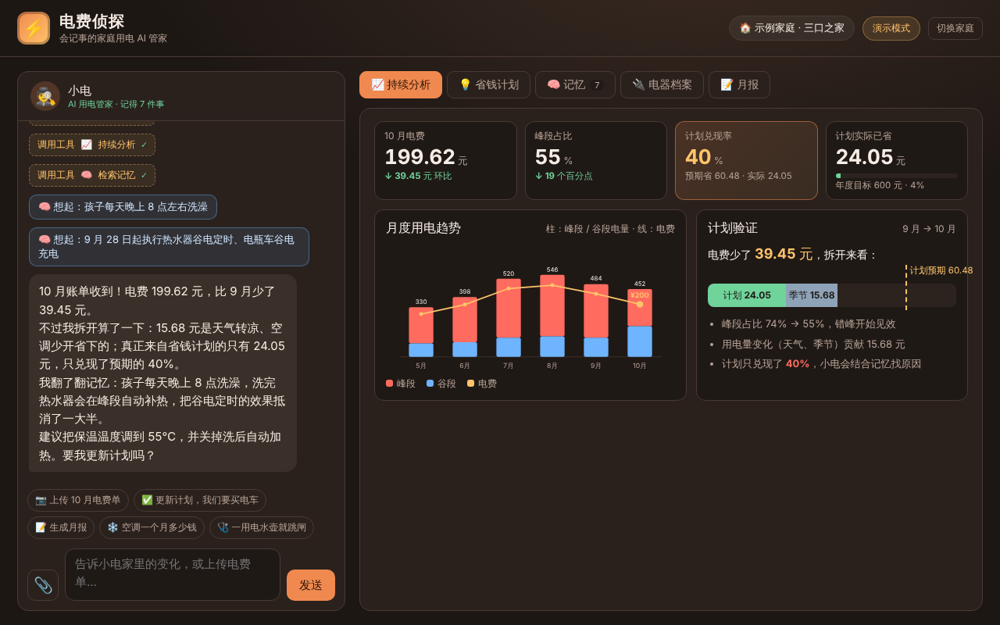
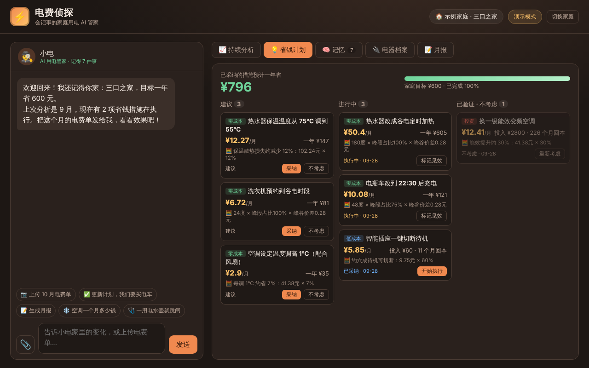
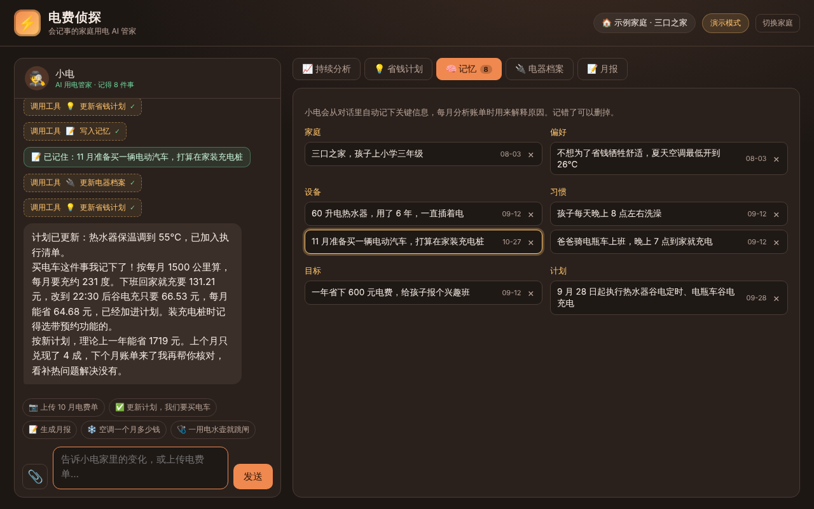
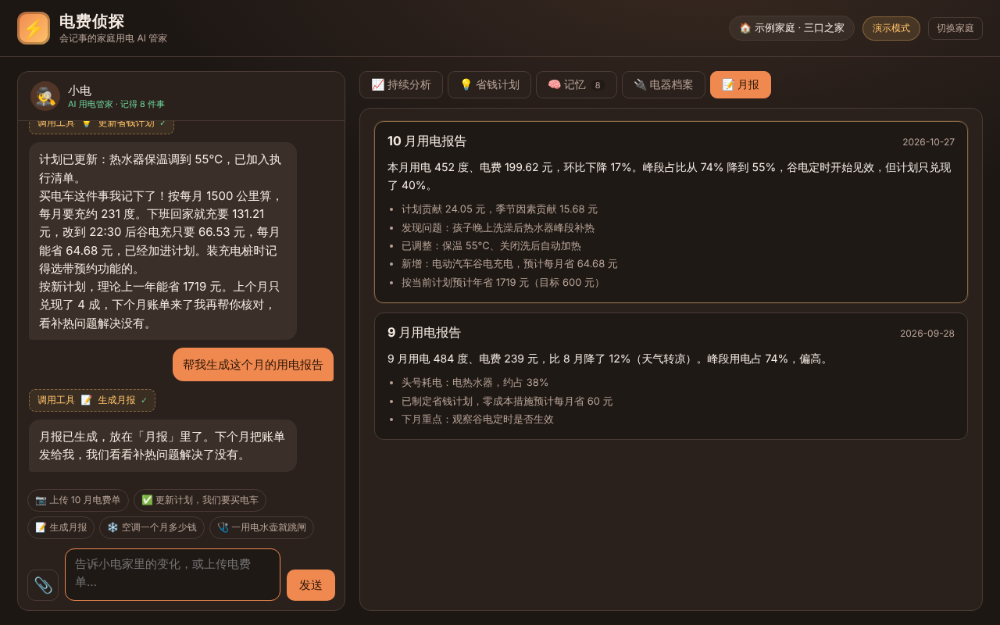
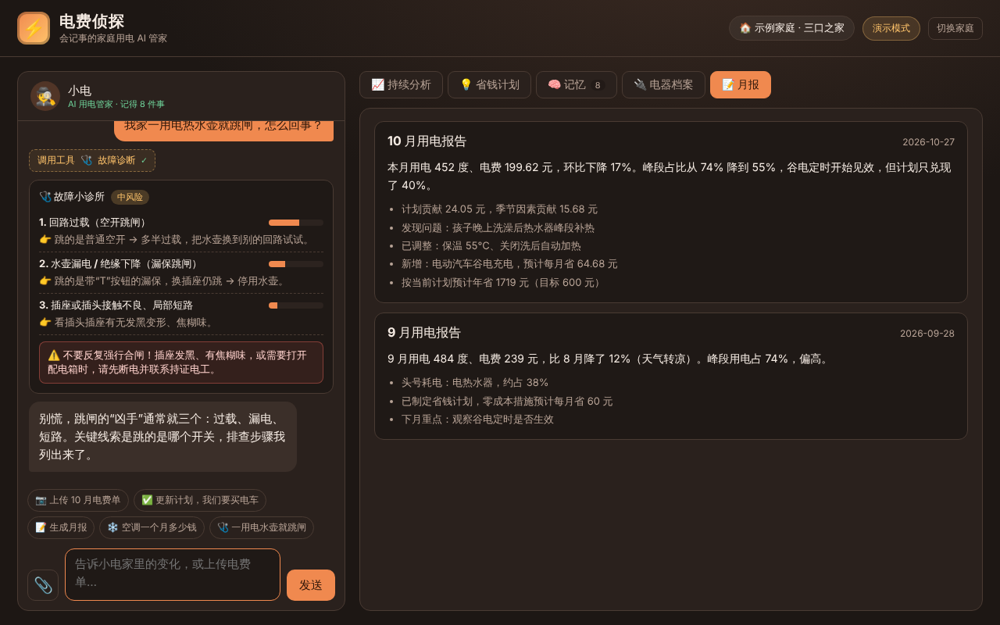

# ⚡ 电费侦探 · Watt Detective

> **记住你家的生活，每月复盘一次账单，把省钱计划从“算一次”变成“持续见效”。**
>
> 会记事的家庭用电 AI 管家（iCAN 大赛 · AI 产品实现赛道作品）

**电费侦探 (Watt Detective)** 将电气工程专业中的**峰谷分时电价、负荷特性与削峰填谷、电器功率与耗电计算、低压保护原理**编写成确定性的**电气计算引擎**，再由大模型负责**看懂电费单照片、听懂家常话、长期记住家庭情况、归因推理电费变化原因**，让普通家庭零门槛用上“需求侧管理”的方法省电费、安全用电。

---

## ✨ 四大核心亮点

1. **🧠 会记事：越用越懂这个家**
   AI 在日常对话中自动识别值得长期记住的信息（家庭成员、作息习惯、电器参数、舒适偏好、省钱目标、计划调整），并在推理时主动调用，界面实时展示“🧠 想起：……”。
2. **📈 会复盘：计划有没有用，用数据说话**
   创新性地将两个月的电费差拆分为**“错峰效果（计入计划）”**与**“用量变化（天气、季节）”**，计算真实的**计划兑现率**，避免“天凉了少开空调电费降了，就误以为省电计划有效”。
3. **🧮 可信设计：大模型负责推理，计算引擎负责数字**
   所有电量、电费、节省金额、兑现率、回本周期均由按电气原理编写的确定性计算引擎（`public/engine.js`）算出，界面同步展示计算公式依据，从机制上杜绝大模型编造数字。
4. **⚡ 专业底色：把需求侧管理带进家庭**
   融合《电力系统分析》《供配电技术》中的峰谷电价、可转移负荷与低压保护原理，每户省钱的同时助力配电网“削峰填谷”；内置“故障小诊所”区分过载、漏电与短路风险，守住安全底线。

---

## 📸 界面预览

| 持续分析与计划验证 | 可验证的省钱计划看板 |
| :---: | :---: |
|  |  |

| 长期记忆档案 | 自动生成月度报告 | 故障小诊所 |
| :---: | :---: | :---: |
|  |  |  |

---

## 🚀 快速开始

### 方式一：离线演示版（零配置，双击即用）

无需安装任何环境、无需联网、无需大模型 API Key：
直接用浏览器双击打开项目根目录下的 **`双击打开-离线演示版.html`**（或 `public/index.html`），即可完整体验：
- 上传示例 10 月电费单 → 拆分节省来源 → 检索记忆找出“孩子 8 点洗澡导致峰段补热”的原因
- 更新省钱计划（含新增电动汽车谷电充电方案）
- 生成月度用电报告、体验单个电器随问随算与“一用电水壶就跳闸”故障诊断

### 方式二：本地服务 + 接入真实大模型

需要 **Node.js 18+**（零第三方 npm 依赖）。

1. 克隆仓库并进入目录：
   ```bash
   git clone https://github.com/realymebrooks-a11y/-.git
   cd -
   ```

2. （可选）配置大模型密钥：复制 `.env.example` 为 `.env`，填入任一大模型配置（支持 DeepSeek、通义千问、Kimi、Claude 等；不配置则自动进入演示模式）：
   ```ini
   # 方式 A：OpenAI 兼容接口（DeepSeek / 通义千问 / Kimi 等）
   OPENAI_API_KEY=sk-xxxx
   OPENAI_BASE_URL=https://api.deepseek.com/v1
   LLM_MODEL=deepseek-chat

   # 方式 B：Anthropic Claude
   ANTHROPIC_API_KEY=sk-ant-xxxx
   LLM_MODEL=claude-sonnet-4-5
   ```

3. 启动服务：
   ```bash
   node server.js
   # 或直接双击 启动-Windows.bat / 启动-Mac或Linux.command
   ```
   浏览器访问 `http://localhost:8787` 即可使用。家庭档案自动保存在本地 `data/household.json`。

---

## 🛠️ 技术架构与工具链

```text
[前端界面 (对话/分析/计划/记忆/电器/月报)]
        ⇅
[AI 智能体 (Claude / DeepSeek / 通义千问 / 演示引擎)]
        ⇅  Function Calling (10 个专用工具)
[确定性电气计算引擎 (engine.js) + 家庭长期档案 (store.js)]
```

### AI 可调用的 10 个核心工具

| 工具名称 | 功能说明 |
| :--- | :--- |
| `add_bill` | 登记某月的峰段、谷段电量，计算当月总电费与峰段占比 |
| `analyze_latest` | 月度趋势、环比、峰段占比变化、异常月份识别、节省拆分与计划兑现率计算 |
| `use_memory` | 标注推理时用到的家庭记忆，在对话流中向用户展示“🧠 想起：……” |
| `remember` / `forget` | 写入新的长期记忆（家庭/习惯/设备/偏好/目标/计划）或删除过时记忆 |
| `set_appliances` | 根据口语描述建立/更新电器清单，重算耗电排行并自动生成个性化省钱措施 |
| `update_plan` | 流转省钱措施状态（`建议` → `已采纳` → `执行中` → `已验证` / `不考虑`） |
| `quick_cost` | 单个电器分步算账（展示功率、负载率、日耗电、峰谷占比与月电费推导过程） |
| `show_diagnosis` | 生成用电故障排查卡片（区分空开过载、漏保动作、短路接触不良及风险等级） |
| `write_report` | 生成并存档月度用电总结报告 |

### 核心电气计算模型（`public/engine.js`）

- **电器月耗电与分时电费**：以 15 分钟为步长计算运行区间落在峰段（08:00–22:00）与谷段（22:00–次日 08:00）的比例：
  $$E = \frac{P \times \text{负载率} \times \text{每日时长} \times \text{天数}}{1000}, \quad \text{电费} = E \times [\alpha_{\text{峰}} P_{\text{峰}} + (1 - \alpha_{\text{峰}}) P_{\text{谷}}]$$
- **电费变化二元拆分模型**：
  $$\Delta C_{\text{错峰（计入计划）}} = (\alpha_{\text{上月峰}} - \alpha_{\text{本月峰}}) \times E_{\text{本月}} \times (P_{\text{峰}} - P_{\text{谷}})$$
  $$\Delta C_{\text{用量（天气/季节）}} = (E_{\text{上月}} - E_{\text{本月}}) \times \bar{P}_{\text{上月}}$$
- **计划兑现率**：
  $$\text{计划兑现率} = \frac{\Delta C_{\text{错峰}}}{\sum \text{已执行移峰措施预期月节省}}$$

---

## 📂 目录结构

```text
watt-detective/
├── public/                     # 前端页面与核心引擎（浏览器与 Node 通用）
│   ├── engine.js               # 电气计算引擎（耗电、峰谷电价、节省拆分、措施库、计划验证）
│   ├── agent.js                # AI 智能体（系统规则、10 个工具定义、三种运行后端）
│   ├── store.js                # 家庭档案与长期记忆存储管理
│   ├── app.js                  # 交互界面与可视化图表渲染
│   ├── app.css                 # 界面样式
│   ├── index.html              # 主应用入口
│   ├── artifact.html           # 在线单页版入口
│   └── assets/                 # 示例电费单图片与内嵌数据
├── screenshots/                # 产品界面截图
├── docs/                       # 产品说明书 PDF（完整设计文档与算例）
│   └── 电费侦探-产品说明书.pdf
├── video/                      # 参赛讲解视频的程序化生成源码（Playwright 逐帧渲染 + 8-bit 混音 + TTS）
├── server.js                   # 零依赖本地 Node 服务（静态托管、大模型 API 代理、档案持久化）
├── 双击打开-离线演示版.html      # 免安装离线快速体验入口
├── 启动-Windows.bat            # Windows 一键启动脚本
├── 启动-Mac或Linux.command     # macOS / Linux 一键启动脚本
├── .env.example                # 环境变量配置模板
└── package.json
```

---

## 📄 许可证

本项目采用 [MIT License](LICENSE) 开源。详细产品设计与算例推导请参阅 [`docs/电费侦探-产品说明书.pdf`](docs/电费侦探-产品说明书.pdf)。
